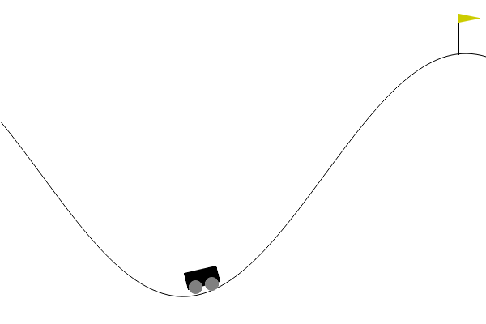

# Lab 1 — MountainCar: Policy Iteration vs Value Iteration



## Files

| File | Contents |
|---|---|
| `mountain_car_setup.py` | discretization, model building (`P`, `R`), Policy Iteration, Value Iteration, testing |
| `lab1_pi_vi.ipynb` | runs, comparison table, conclusions, plots, simulation, grid size experiment |

## Approach

- The continuous state (position, velocity) is split into a 200×200 grid → 40 000 discrete states.
- The physics is deterministic, so the model is built with one simulated step per (state, action).
- PI and VI are run on the same model with γ = 0.99, θ = ε = 1e-4, then tested on 100 episodes in the real environment.

## Results

| | Policy Iteration | Value Iteration |
|---|---|---|
| Outer iterations | 93 | 110 |
| Total sweeps over all states | ~4 300 | 110 |
| Training time | ~0.8 s | ~0.1 s |
| Success rate | 100% | 100% |
| Mean steps to flag | 120.4 | 120.4 |

- Both methods converge to the same V and the same policy.
- VI is faster: PI runs a full policy evaluation on every outer iteration, VI combines evaluation and improvement in one `max` update per sweep.

## Run

From the repository root:

```bash
python -m venv .venv
.venv/bin/pip install -r requirements.txt
.venv/bin/jupyter notebook lab1_pi_vi/lab1_pi_vi.ipynb
```
