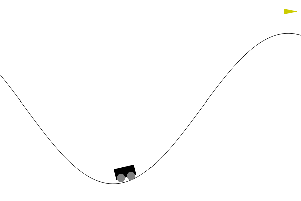

# Lab 2 — MountainCar: Monte Carlo control vs Policy / Value Iteration

| Height shaping | Energy shaping |
|---|---|
|  |  |

## Files

| File | Contents |
|---|---|
| `mc_mountaincar.py` | reward shaping, ε-greedy, first-visit MC control, testing |
| `lab2_mc.ipynb` | training, learning curves, comparison with PI/VI from Lab 1, conclusions, plots |

PI/VI and the discretization are reused from `../lab1_pi_vi/mountain_car_setup.py`.

## Approach

- Model-free: the agent learns only from played episodes (`reset` / `step`), no access to `P`, `R`.
- Grid 20×20 (coarser than Lab 1, so every state is visited often enough).
- Reward shaping by height: `r + k·(height(s') − height(s))`, k = 100.
- First-visit MC, α = 0.02, ε: 1.0 → ×0.9995 per episode → min 0.05, 20 000 episodes, γ = 0.99.

## Results

| | PI (200×200) | VI (200×200) | MC, height (20×20) | MC, energy (20×20) |
|---|---|---|---|---|
| Access to model | yes | yes | no | no |
| Training time | ~0.7 s | ~0.1 s | ~40 s | ~40 s |
| Success rate | 100% | 100% | 100% | 100% |
| Mean steps to flag | 120.4 | 120.4 | 153.5 | 146.7 |

- Energy shaping (`E = 0.0025·sin(3p)/3 + v²/2`, k = 50 000) learns ~2× faster than height shaping: it does not punish rolling down, only rewards pushes that add energy.

- MC is much slower: it has to explore by playing, PI/VI read the exact model.
- Without shaping MC learns nothing (0% success): the original reward is sparse.
- MC policy works but is not optimal: coarse grid, limited episodes, shaped objective.
