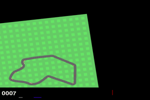

# Lab 3 — CarRacing-v3: improving the baseline DQN



## Files

| Path | Contents |
|---|---|
| `lab3.ipynb` | **report**: results table, ablations, learning curves, snapshot analysis, conclusions |
| `dqn_car_racing.py` | improved DQN; each improvement is a switch in `CONFIGS` (`baseline` = original code) |
| `dqn_car_racing_baseline.py` | original baseline code, unchanged |
| `test_car_racing.py` | original test script + optional `--no-dueling` flag to test baseline / non-dueling checkpoints (default behavior unchanged) |
| `checkpoints/final_CarRacing-v3.pth` | **final checkpoint** (final_long, snapshot at episode 1100) |
| `checkpoints/checkpoint_CarRacing-v3_best.pth` | provided baseline checkpoint |
| `kaggle/train_ablations.ipynb` | Kaggle run: baseline + ablations + final, 1000 episodes each → `runs/ablations/` |
| `kaggle/train_final_long.ipynb` | Kaggle run: longer final, 2000 episodes + snapshot selection → `runs/final_long/` |

## Changes

- **Double DQN**: the online net picks the next action, the target net evaluates it (less overestimation).
- **Dueling head**: `Q = V(s) + A(s,a) − mean A`.
- **ε decay per env step** (1.0 → 0.05 over 200k steps) + 10k warm-up steps, instead of decay per episode.
- Final run: 2000 episodes, ε → 0.01, checkpoint picked by a greedy test of snapshots every 100 episodes.

## Results (50 test episodes)

| | Mean | Std | Min | Max |
|---|---|---|---|---|
| baseline checkpoint (from the task) | 840.6 | 103.2 | 470.4 | 912.7 |
| baseline checkpoint (re-test here) | 809.3 | 150.2 | 358.7 | 927.6 |
| final (1000 ep) | 894.8 | 43.0 | 697.5 | 926.7 |
| **final_long, ep1100 (Kaggle)** | **895.2** | **26.5** | **796.3** | 930.2 |
| **final_long, ep1100 (re-test here)** | **899.7** | **19.1** | **856.5** | 924.8 |

```
cd lab3
python test_car_racing.py checkpoints/final_CarRacing-v3.pth 50
python dqn_car_racing.py final 1000      # train a config (output in runs/)
```
